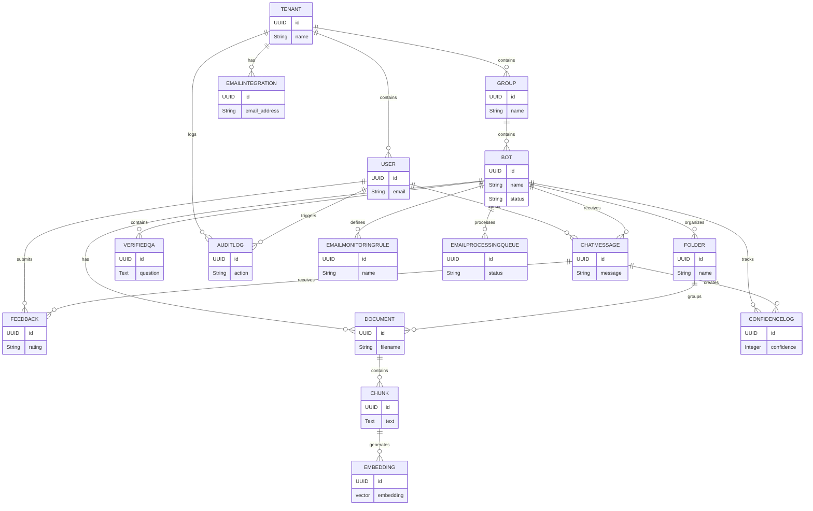

# Veriply — Data Models & Database Schema

## Database Overview

**Database System:** PostgreSQL 16 with pgvector extension  
**Location:** External at 10.2.160.214  
**ORM:** SQLAlchemy 2.x (async)  
**Migrations:** Alembic

## Entity Relationship Diagram



## Core Tables

### Tenant

Multi-tenant organization data.

```sql
CREATE TABLE tenants (
    id UUID PRIMARY KEY DEFAULT gen_random_uuid(),
    name VARCHAR(100) NOT NULL,
    created_at TIMESTAMP DEFAULT NOW(),
    updated_at TIMESTAMP DEFAULT NOW(),
    INDEX: ix_tenants_name
);
```

| Column | Type | Constraints | Purpose |
|--------|------|-----------|---------|
| `id` | UUID | PK | Unique identifier |
| `name` | VARCHAR(100) | NOT NULL | Organization name |
| `created_at` | TIMESTAMP | DEFAULT NOW | Creation timestamp |
| `updated_at` | TIMESTAMP | DEFAULT NOW | Last update |

### User

User accounts with tenant FK.

```sql
CREATE TABLE users (
    id UUID PRIMARY KEY DEFAULT gen_random_uuid(),
    tenant_id UUID NOT NULL REFERENCES tenants(id),
    email VARCHAR(255) UNIQUE NOT NULL,
    password_hash VARCHAR(255) NOT NULL,
    role VARCHAR(50) DEFAULT 'member',
    is_active BOOLEAN DEFAULT true,
    last_login TIMESTAMP,
    created_at TIMESTAMP DEFAULT NOW(),
    updated_at TIMESTAMP DEFAULT NOW(),
    
    INDEX: ix_users_tenant_id
    INDEX: ix_users_email
    UNIQUE CONSTRAINT: (tenant_id, email)
);
```

| Column | Type | Purpose |
|--------|------|---------|
| `id` | UUID | User identifier |
| `tenant_id` | UUID | Tenant reference (FK) |
| `email` | VARCHAR(255) | Login email |
| `password_hash` | VARCHAR(255) | Bcrypt hashed password |
| `role` | VARCHAR(50) | owner \| admin \| member |
| `is_active` | BOOLEAN | Account status |
| `last_login` | TIMESTAMP | Last login time |

**Row-Level Security:** Users can only access their own tenant data

### Group

Team/group for organizing bots and permissions.

```sql
CREATE TABLE groups (
    id UUID PRIMARY KEY DEFAULT gen_random_uuid(),
    tenant_id UUID NOT NULL REFERENCES tenants(id),
    name VARCHAR(100) NOT NULL,
    description TEXT,
    created_by UUID NOT NULL REFERENCES users(id),
    created_at TIMESTAMP DEFAULT NOW(),
    updated_at TIMESTAMP DEFAULT NOW(),
    
    INDEX: ix_groups_tenant_id
    UNIQUE CONSTRAINT: (tenant_id, name)
);
```

| Column | Type | Purpose |
|--------|------|---------|
| `id` | UUID | Group identifier |
| `tenant_id` | UUID | Parent tenant |
| `name` | VARCHAR(100) | Team name |
| `description` | TEXT | Group description |
| `created_by` | UUID | Creator user (FK) |

### Bot

AI knowledge base bot.

```sql
CREATE TABLE bots (
    id UUID PRIMARY KEY DEFAULT gen_random_uuid(),
    tenant_id UUID NOT NULL REFERENCES tenants(id),
    group_id UUID REFERENCES groups(id) ON DELETE CASCADE,
    name VARCHAR(50) NOT NULL,
    description TEXT,
    status VARCHAR(50) DEFAULT 'Empty', -- Empty | Processing | Ready
    confidence_threshold INTEGER DEFAULT 80,
    avatar_url VARCHAR(512),
    is_public BOOLEAN DEFAULT false,
    is_active BOOLEAN DEFAULT true,
    created_by UUID NOT NULL REFERENCES users(id),
    created_at TIMESTAMP DEFAULT NOW(),
    updated_at TIMESTAMP DEFAULT NOW(),
    
    INDEX: ix_bots_tenant_id
    INDEX: ix_bots_group_id
    INDEX: ix_bots_tenant_group_created
    UNIQUE CONSTRAINT: (tenant_id, group_id, name)
);
```

| Column | Type | Purpose |
|--------|------|---------|
| `id` | UUID | Bot identifier |
| `tenant_id` | UUID | Parent tenant (FK) |
| `group_id` | UUID | Parent group (FK) |
| `name` | VARCHAR(50) | Bot display name |
| `status` | VARCHAR(50) | Empty \| Processing \| Ready |
| `confidence_threshold` | INTEGER | Minimum confidence to respond (0-100) |
| `is_public` | BOOLEAN | Allow public chat access |
| `is_active` | BOOLEAN | Enable/disable bot |

### Folder

Document organization.

```sql
CREATE TABLE folders (
    id UUID PRIMARY KEY DEFAULT gen_random_uuid(),
    tenant_id UUID NOT NULL REFERENCES tenants(id),
    bot_id UUID NOT NULL REFERENCES bots(id) ON DELETE CASCADE,
    name VARCHAR(100) NOT NULL,
    description TEXT,
    parent_id UUID REFERENCES folders(id),
    created_at TIMESTAMP DEFAULT NOW(),
    
    INDEX: ix_folders_bot_id
    UNIQUE CONSTRAINT: (bot_id, parent_id, name)
);
```

| Column | Type | Purpose |
|--------|------|---------|
| `id` | UUID | Folder identifier |
| `bot_id` | UUID | Parent bot (FK) |
| `name` | VARCHAR(100) | Folder name |
| `parent_id` | UUID | Parent folder (FK) for nesting |

### Document

Knowledge base documents.

```sql
CREATE TABLE documents (
    id UUID PRIMARY KEY DEFAULT gen_random_uuid(),
    tenant_id UUID NOT NULL REFERENCES tenants(id),
    bot_id UUID NOT NULL REFERENCES bots(id) ON DELETE CASCADE,
    folder_id UUID REFERENCES folders(id),
    filename VARCHAR(255) NOT NULL,
    file_size INTEGER,
    mime_type VARCHAR(100),
    status VARCHAR(50) DEFAULT 'Pending', -- Pending | Processing | Ready | Error
    file_path VARCHAR(512),
    created_at TIMESTAMP DEFAULT NOW(),
    updated_at TIMESTAMP DEFAULT NOW(),
    
    INDEX: ix_documents_bot_id
    INDEX: ix_documents_folder_id
);
```

| Column | Type | Purpose |
|--------|------|---------|
| `id` | UUID | Document identifier |
| `bot_id` | UUID | Associated bot (FK) |
| `filename` | VARCHAR(255) | Original filename |
| `file_size` | INTEGER | Size in bytes |
| `status` | VARCHAR(50) | Processing status |
| `file_path` | VARCHAR(512) | Storage location path |

### Chunk

Text segments from documents (for RAG).

```sql
CREATE TABLE chunks (
    id UUID PRIMARY KEY DEFAULT gen_random_uuid(),
    document_id UUID NOT NULL REFERENCES documents(id) ON DELETE CASCADE,
    bot_id UUID NOT NULL REFERENCES bots(id),
    text TEXT NOT NULL,
    page_number INTEGER,
    chunk_index INTEGER,
    metadata JSON,
    created_at TIMESTAMP DEFAULT NOW(),
    
    INDEX: ix_chunks_document_id
    INDEX: ix_chunks_bot_id
);
```

| Column | Type | Purpose |
|--------|------|---------|
| `id` | UUID | Chunk identifier |
| `document_id` | UUID | Source document (FK) |
| `text` | TEXT | Chunk text content |
| `page_number` | INTEGER | Source page (PDF) |
| `metadata` | JSON | Additional metadata |

### Embedding

Vector embeddings for semantic search (pgvector).

```sql
CREATE TABLE embeddings (
    id UUID PRIMARY KEY DEFAULT gen_random_uuid(),
    chunk_id UUID NOT NULL REFERENCES chunks(id) ON DELETE CASCADE,
    embedding vector(384),  -- bge-m3 produces 384-dim vectors
    created_at TIMESTAMP DEFAULT NOW(),
    
    INDEX: ix_embeddings_chunk_id
    INDEX: ix_embeddings_vector (embedding vector_cosine_ops) USING HNSW
);

-- Use HNSW (Hierarchical Navigable Small World) for fast search
-- ALTER INDEX ix_embeddings_vector SET (lists = 100);
```

| Column | Type | Purpose |
|--------|------|---------|
| `id` | UUID | Embedding identifier |
| `chunk_id` | UUID | Source chunk (FK) |
| `embedding` | vector(384) | Vector representation |

### ChatMessage

Chat history and conversation.

```sql
CREATE TABLE chat_messages (
    id UUID PRIMARY KEY DEFAULT gen_random_uuid(),
    tenant_id UUID NOT NULL REFERENCES tenants(id),
    bot_id UUID NOT NULL REFERENCES bots(id) ON DELETE CASCADE,
    user_id UUID REFERENCES users(id),
    conversation_id UUID,
    role VARCHAR(50), -- user | assistant
    message TEXT NOT NULL,
    response TEXT,
    confidence INTEGER,
    source_documents JSON,
    created_at TIMESTAMP DEFAULT NOW(),
    
    INDEX: ix_chat_messages_bot_id
    INDEX: ix_chat_messages_conversation_id
    INDEX: ix_chat_messages_user_id
);
```

| Column | Type | Purpose |
|--------|------|---------|
| `id` | UUID | Message identifier |
| `bot_id` | UUID | Associated bot (FK) |
| `user_id` | UUID | User who sent message |
| `conversation_id` | UUID | Conversation grouping |
| `message` | TEXT | User query |
| `response` | TEXT | Bot response |
| `confidence` | INTEGER | LLM confidence (0-100) |

### ConfidenceLog

Tracks low-confidence responses for HITL.

```sql
CREATE TABLE confidence_logs (
    id UUID PRIMARY KEY DEFAULT gen_random_uuid(),
    tenant_id UUID NOT NULL REFERENCES tenants(id),
    bot_id UUID NOT NULL REFERENCES bots(id),
    chat_message_id UUID NOT NULL REFERENCES chat_messages(id),
    confidence INTEGER NOT NULL,
    status VARCHAR(50) DEFAULT 'pending', -- pending | approved | rejected
    reason TEXT,
    reviewed_by UUID REFERENCES users(id),
    reviewed_at TIMESTAMP,
    created_at TIMESTAMP DEFAULT NOW(),
    
    INDEX: ix_confidence_logs_bot_id
    INDEX: ix_confidence_logs_status
);

-- Data Retention: Delete after 180 days
```

### Feedback

User feedback on answers.

```sql
CREATE TABLE feedback (
    id UUID PRIMARY KEY DEFAULT gen_random_uuid(),
    chat_message_id UUID NOT NULL REFERENCES chat_messages(id) ON DELETE CASCADE,
    user_id UUID NOT NULL REFERENCES users(id),
    rating VARCHAR(50), -- positive | neutral | negative
    reason VARCHAR(100),
    comment TEXT,
    created_at TIMESTAMP DEFAULT NOW(),
    
    INDEX: ix_feedback_chat_message_id
);

-- Data Retention: Delete after 365 days
```

### VerifiedQA

Manually curated Q&A entries (separate from AI-generated).

```sql
CREATE TABLE verified_qa (
    id UUID PRIMARY KEY DEFAULT gen_random_uuid(),
    bot_id UUID NOT NULL REFERENCES bots(id) ON DELETE CASCADE,
    question TEXT NOT NULL,
    answer TEXT NOT NULL,
    created_by UUID NOT NULL REFERENCES users(id),
    created_at TIMESTAMP DEFAULT NOW(),
    updated_at TIMESTAMP DEFAULT NOW()
);
```

### EmailIntegration

Gmail account integrations.

```sql
CREATE TABLE email_integrations (
    id UUID PRIMARY KEY DEFAULT gen_random_uuid(),
    tenant_id UUID NOT NULL REFERENCES tenants(id),
    email_address VARCHAR(255) NOT NULL,
    oauth_access_token TEXT NOT NULL,
    oauth_refresh_token TEXT NOT NULL,
    is_active BOOLEAN DEFAULT true,
    last_sync TIMESTAMP,
    connected_at TIMESTAMP DEFAULT NOW(),
    
    INDEX: ix_email_integrations_tenant_id
    UNIQUE CONSTRAINT: (tenant_id, email_address)
);
```

### EmailMonitoringRule

Auto-reply rules for incoming emails.

```sql
CREATE TABLE email_monitoring_rules (
    id UUID PRIMARY KEY DEFAULT gen_random_uuid(),
    bot_id UUID NOT NULL REFERENCES bots(id) ON DELETE CASCADE,
    name VARCHAR(100) NOT NULL,
    keyword_filter VARCHAR(500),
    enable_auto_reply BOOLEAN DEFAULT false,
    auto_reply_template TEXT,
    created_at TIMESTAMP DEFAULT NOW(),
    
    INDEX: ix_email_monitoring_rules_bot_id
);
```

### EmailProcessingQueue

Queue for email processing.

```sql
CREATE TABLE email_processing_queue (
    id UUID PRIMARY KEY DEFAULT gen_random_uuid(),
    bot_id UUID NOT NULL REFERENCES bots(id),
    sender_email VARCHAR(255),
    subject VARCHAR(255),
    body TEXT,
    status VARCHAR(50) DEFAULT 'pending', -- pending | processing | completed | failed
    ai_response TEXT,
    confidence INTEGER,
    created_at TIMESTAMP DEFAULT NOW(),
    processed_at TIMESTAMP,
    
    INDEX: ix_email_queue_status
);
```

### AuditLog

Compliance audit trail.

```sql
CREATE TABLE audit_logs (
    id UUID PRIMARY KEY DEFAULT gen_random_uuid(),
    tenant_id UUID NOT NULL REFERENCES tenants(id),
    user_id UUID REFERENCES users(id),
    action VARCHAR(100), -- create | update | delete | export | login
    resource_type VARCHAR(100), -- user | bot | document
    resource_id UUID,
    details JSON,
    created_at TIMESTAMP DEFAULT NOW(),
    
    INDEX: ix_audit_logs_tenant_id
    INDEX: ix_audit_logs_action
);

-- Data Retention: Delete after 3 years (for compliance)
```

## Key Indexes

| Table | Index | Columns | Purpose |
|-------|-------|---------|---------|
| users | ix_users_tenant_id | tenant_id | Multi-tenant isolation |
| users | ix_users_email | email | Login lookup |
| bots | ix_bots_tenant_group | (tenant_id, group_id) | Tenant + group scoping |
| documents | ix_documents_bot_id | bot_id | Bot document filtering |
| chunks | ix_chunks_document_id | document_id | Document chunk retrieval |
| embeddings | ix_embeddings_vector | embedding | Vector similarity search (HNSW) |
| chat_messages | ix_chat_messages_bot_id | bot_id | Chat history retrieval |
| chat_messages | ix_chat_messages_user_id | user_id | User activity tracking |

## Relationships Summary

| From | To | Type | Constraints |
|------|----|----|-------------|
| User | Tenant | N:1 | Required FK |
| Group | Tenant | N:1 | Required FK |
| Bot | Tenant | N:1 | Required FK |
| Bot | Group | N:1 | Optional FK |
| Document | Bot | N:1 | Required FK, CASCADE delete |
| Chunk | Document | N:1 | Required FK, CASCADE delete |
| Embedding | Chunk | N:1 | Required FK, CASCADE delete |
| ChatMessage | Bot | N:1 | Required FK, CASCADE delete |
| ChatMessage | User | N:1 | Optional FK |
| VerifiedQA | Bot | N:1 | Required FK, CASCADE delete |
| EmailIntegration | Tenant | N:1 | Required FK |
| AuditLog | Tenant | N:1 | Required FK |

## Data Retention Policy

| Table | Retention | Reason | Cleanup |
|-------|-----------|--------|---------|
| ChatMessage | 90 days | Storage optimization | Auto-delete after 90 days |
| ConfidenceLog | 180 days | Audit trail | Auto-delete after 180 days |
| Feedback | 365 days | Analytics | Auto-delete after 365 days |
| AuditLog | 3 years | Legal compliance | Auto-delete after 3 years |

## Row-Level Security (RLS)

Implemented for multi-tenant isolation:

```sql
-- All tables have tenant_id column
-- RLS policies ensure users can only access their tenant's data

CREATE POLICY users_isolation ON users
    USING (tenant_id = current_setting('app.current_tenant_id')::uuid);

CREATE POLICY bots_isolation ON bots
    USING (tenant_id = current_setting('app.current_tenant_id')::uuid);

-- Similar policies for all tenant-scoped tables
```

RLS is enabled on startup by `apps/api/app/core/migrations.py:enable_rls()`

## Vector Search

pgvector HNSW index for semantic search:

```sql
-- Query embeddings by vector similarity
SELECT 
    chunks.text,
    documents.filename,
    1 - (embeddings.embedding <=> query_embedding) as similarity
FROM embeddings
JOIN chunks ON embeddings.chunk_id = chunks.id
JOIN documents ON chunks.document_id = documents.id
WHERE bots.id = $bot_id
ORDER BY embeddings.embedding <=> query_embedding
LIMIT 5;

-- HNSW index provides O(log N) search complexity
-- Configured for 384-dimensional vectors (bge-m3)
```

---

**Generated:** January 11, 2026  
**Database Version:** PostgreSQL 16 + pgvector  
**ORM:** SQLAlchemy 2.x (Async)
