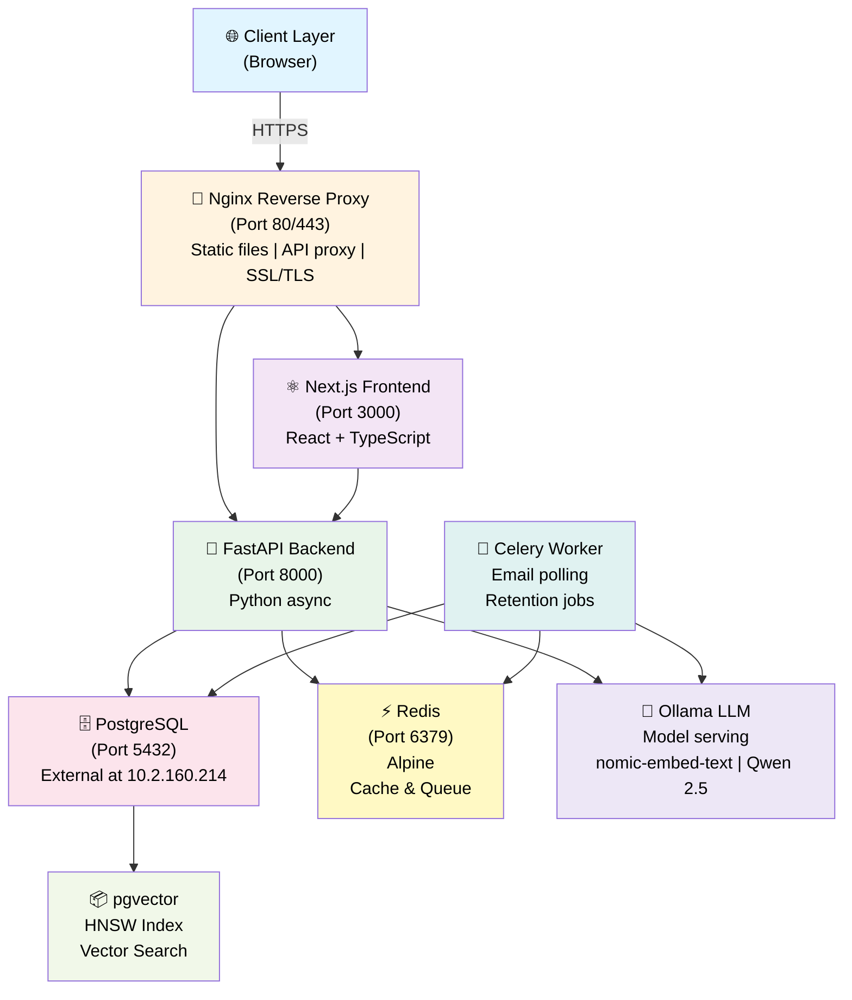

# Veriply — Deployment Guide

## Deployment Architecture

Veriply uses Docker Compose for orchestration with the following services:



## Docker Compose Configuration

### Current Setup

The `docker-compose.yml` includes:

- **Redis** (Alpine image) — Session caching and Celery queue
- **PostgreSQL** — Currently commented out (using external DB at 10.2.160.214)
- **Ollama** — LLM inference (optional, can use external)
- **Nginx** — Reverse proxy (optional for production)

### Environment Variables in docker-compose

Load from `.env` automatically:

```yaml
version: "3.8"
services:
  redis:
    environment:
      - REDIS_PASSWORD=${REDIS_PASSWORD}
    ports:
      - "${REDIS_PORT:-6379}:6379"
```

## Deployment Options

### Option 1: Local Development (Docker Compose)

**Best for:** Development, testing, local demos

```bash
# Start all services
docker-compose up -d

# Verify services
docker-compose ps

# View logs
docker-compose logs -f

# Stop services
docker-compose down
```

**Pros:**
- Easy local testing
- Matches production environment
- All services on one machine

**Cons:**
- Not scalable
- Single point of failure
- No high availability

### Option 2: VPS Deployment (Docker Compose on Ubuntu)

**Best for:** Small-to-medium production deployments, single server

#### 1. Server Setup

```bash
# SSH into Ubuntu server
ssh root@<server-ip>

# Install Docker & Docker Compose
curl -fsSL https://get.docker.com -o get-docker.sh
sudo sh get-docker.sh
sudo curl -L "https://github.com/docker/compose/releases/download/v2.x.x/docker-compose-$(uname -s)-$(uname -m)" -o /usr/local/bin/docker-compose
sudo chmod +x /usr/local/bin/docker-compose

# Create app directory
mkdir -p /opt/veriply
cd /opt/veriply
```

#### 2. Clone Repository

```bash
git clone <repo-url> .

# Setup environment
cp .env.example .env
# Edit .env with production credentials
nano .env
```

#### 3. SSL/TLS Certificate (LetsEncrypt)

```bash
# Install certbot
sudo apt-get install certbot python3-certbot-nginx

# Generate certificate
sudo certbot certonly --standalone -d yourdomain.com

# Certs stored in /etc/letsencrypt/live/yourdomain.com/
# Update Nginx config to point to these paths
```

#### 4. Start Services

```bash
docker-compose up -d

# Enable auto-restart
docker-compose ps

# Setup daily restart for updates
crontab -e
# Add: 0 2 * * * docker-compose -f /opt/veriply/docker-compose.yml restart
```

#### 5. Monitoring

```bash
# Monitor service health
docker-compose logs -f api
docker-compose logs -f web
docker-compose logs -f redis

# Check disk usage
df -h
du -sh /opt/veriply

# Monitor resource usage
docker stats
```

### Option 3: Kubernetes Deployment

**Best for:** Enterprise, multi-region, high availability

#### Prerequisites

- Kubernetes cluster (EKS, GKE, AKS)
- kubectl CLI configured
- Helm package manager (optional, recommended)

#### Create Kubernetes Manifests

**Deployment:** `k8s/api-deployment.yaml`

```yaml
apiVersion: apps/v1
kind: Deployment
metadata:
  name: veriply-api
spec:
  replicas: 3
  selector:
    matchLabels:
      app: veriply-api
  template:
    metadata:
      labels:
        app: veriply-api
    spec:
      containers:
      - name: api
        image: veriply-api:latest
        ports:
        - containerPort: 8000
        env:
        - name: DB_HOST
          valueFrom:
            configMapKeyRef:
              name: veriply-config
              key: db-host
        - name: DATABASE_URL
          valueFrom:
            secretKeyRef:
              name: veriply-secrets
              key: database-url
        livenessProbe:
          httpGet:
            path: /healthz
            port: 8000
          initialDelaySeconds: 30
          periodSeconds: 10
        resources:
          requests:
            cpu: 500m
            memory: 512Mi
          limits:
            cpu: 1000m
            memory: 1Gi
      - name: worker
        image: veriply-api:latest
        command: ["python", "-m", "app.worker"]
        env:
        - name: DATABASE_URL
          valueFrom:
            secretKeyRef:
              name: veriply-secrets
              key: database-url
```

**Service:** `k8s/api-service.yaml`

```yaml
apiVersion: v1
kind: Service
metadata:
  name: veriply-api
spec:
  type: ClusterIP
  ports:
  - port: 8000
    targetPort: 8000
  selector:
    app: veriply-api
```

**ConfigMap:** `k8s/configmap.yaml`

```yaml
apiVersion: v1
kind: ConfigMap
metadata:
  name: veriply-config
data:
  db-host: "postgres.default.svc.cluster.local"
  redis-host: "redis.default.svc.cluster.local"
```

#### Deploy to Kubernetes

```bash
# Create namespace
kubectl create namespace veriply

# Create secrets
kubectl create secret generic veriply-secrets \
  --from-literal=database-url=$DATABASE_URL \
  --from-literal=jwt-secret=$JWT_SECRET \
  -n veriply

# Apply manifests
kubectl apply -f k8s/ -n veriply

# Verify deployment
kubectl get pods -n veriply
kubectl logs -f pod/veriply-api-xxxxx -n veriply
```

## Production Environment Variables

Create `.env.production`:

```bash
# ============================================================================
# ENVIRONMENT & DEBUG
# ============================================================================
ENVIRONMENT=production
DEBUG=false

# ============================================================================
# DATABASE
# ============================================================================
DB_HOST=<your-db-host>
DB_PORT=5432
DB_USER=<secure-username>
DB_PASSWORD=<secure-password>
DB_NAME=veriply_prod
DATABASE_URL=postgresql+asyncpg://${DB_USER}:${DB_PASSWORD}@${DB_HOST}:${DB_PORT}/${DB_NAME}

# ============================================================================
# REDIS
# ============================================================================
REDIS_HOST=<redis-host>
REDIS_PORT=6379
REDIS_PASSWORD=<secure-password>

# ============================================================================
# OLLAMA (LLM)
# ============================================================================
OLLAMA_HOST=http://<ollama-host>:11434
OLLAMA_MODEL=qwen2.5:14b
OLLAMA_EMBEDDING_MODEL=bge-m3

# ============================================================================
# SECURITY
# ============================================================================
JWT_SECRET=<generate-with: python -c "import secrets; print(secrets.token_urlsafe(32))">
CORS_ORIGINS=https://yourdomain.com,https://www.yourdomain.com

# ============================================================================
# EMAIL (Gmail)
# ============================================================================
GMAIL_CLIENT_ID=<oauth-client-id>
GMAIL_CLIENT_SECRET=<oauth-client-secret>
GMAIL_REDIRECT_URI=https://yourdomain.com/api/auth/gmail/callback

# SMTP for sending
SMTP_HOST=smtp.gmail.com
SMTP_PORT=587
SMTP_USER=<gmail-app-email>
SMTP_PASSWORD=<app-password>
SMTP_FROM=noreply@yourdomain.com

EMAIL_POLL_INTERVAL_SECONDS=300

# ============================================================================
# STORAGE
# ============================================================================
UPLOAD_MAX_SIZE_MB=50
STORAGE_PATH=/mnt/storage

# ============================================================================
# OBSERVABILITY
# ============================================================================
LOG_LEVEL=INFO
SENTRY_DSN=https://<your-sentry-dsn>

# ============================================================================
# FEATURE FLAGS
# ============================================================================
FEATURE_EMAIL_INTEGRATION=true
FEATURE_HITL_QUEUE=true
FEATURE_VERIFIED_QA=true
```

## Backup & Disaster Recovery

### Database Backups

```bash
# Daily backup script (add to crontab)
#!/bin/bash
BACKUP_DIR="/backups/veriply"
DATE=$(date +%Y%m%d_%H%M%S)
DB_HOST="10.2.160.214"
DB_NAME="veriply_prod"
DB_USER="veriply_user"

pg_dump -h $DB_HOST -U $DB_USER -d $DB_NAME | gzip > $BACKUP_DIR/veriply_$DATE.sql.gz

# Keep only last 30 days of backups
find $BACKUP_DIR -name "veriply_*.sql.gz" -mtime +30 -delete
```

### Restore from Backup

```bash
# Decompress and restore
gunzip < /backups/veriply/veriply_20260110_120000.sql.gz | psql -h 10.2.160.214 -U veriply_user -d veriply_prod
```

## Monitoring & Health Checks

### Health Check Endpoint

```bash
curl http://localhost:8000/healthz
```

Response:
```json
{
  "status": "healthy",
  "environment": "production",
  "database": {"host": "...", "port": 5432, "name": "..."},
  "ollama": {"host": "...", "model": "qwen2.5:14b"}
}
```

### Prometheus Metrics (Optional)

Add to `apps/api/requirements.txt`:

```
prometheus-client
```

Export metrics:

```python
from prometheus_client import Counter, Histogram

request_count = Counter('veriply_requests_total', 'Total requests')
request_duration = Histogram('veriply_request_duration_seconds', 'Request duration')

@app.middleware("http")
async def metrics_middleware(request, call_next):
    request_count.inc()
    with request_duration.time():
        response = await call_next(request)
    return response
```

### Log Aggregation

Forward logs to external service:

```bash
# Using ELK Stack or Datadog
# Configure in docker-compose.yml or k8s manifests
docker-compose logs --follow | nc loggly.server 514
```

## Security Checklist

- ✅ Enable HTTPS/TLS (LetsEncrypt)
- ✅ Set strong JWT_SECRET
- ✅ Restrict CORS to known domains
- ✅ Use environment variables for secrets
- ✅ Enable Row-Level Security (RLS) in PostgreSQL
- ✅ Regular database backups
- ✅ Monitor logs for errors and attacks
- ✅ Keep dependencies updated
- ✅ Implement rate limiting
- ✅ Setup Web Application Firewall (WAF)

## Scaling Considerations

### Horizontal Scaling (Multiple Instances)

1. **Load Balancing**
   - Use Nginx, HAProxy, or cloud load balancer
   - Route to multiple API instances
   - Session management via Redis (not in-memory)

2. **Database Connection Pooling**
   - Use PgBouncer for connection pooling
   - Configure in SQLAlchemy: `pool_size=20, max_overflow=40`

3. **Cache Layer**
   - Redis for session and caching
   - Distributed across instances

4. **Background Workers**
   - Multiple Celery worker instances
   - Queue-based (Redis Streams)
   - Auto-scale based on queue depth

### Vertical Scaling (Larger Machine)

- Increase CPU cores → Better LLM performance
- Increase RAM → Larger vector index caching
- Increase disk → More document storage

## Disaster Recovery Plan

| Component | RTO | RPO | Recovery Method |
|-----------|-----|-----|-----------------|
| API Code | 5 min | 0 min | Git rollback, re-deploy |
| Database | 30 min | 1 hour | Restore from latest backup |
| Redis Cache | 5 min | OK to lose | Rebuilt on restart |
| Documents | 30 min | 1 hour | Restore from S3/storage backup |

## Rollback Procedure

```bash
# If deployment fails, rollback to previous version
git log --oneline | head -10
git revert <commit-hash>
docker-compose rebuild
docker-compose up -d
```

---

**Generated:** January 11, 2026  
**Scan Level:** Deep Scan  
**Database:** PostgreSQL 16 (External at 10.2.160.214)
